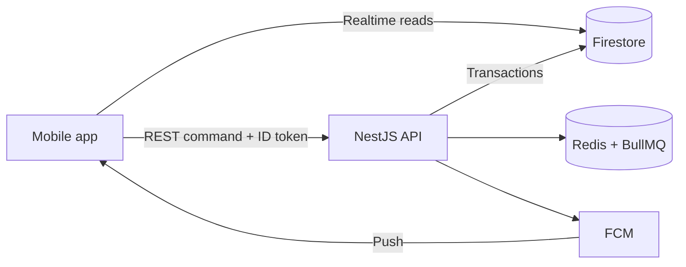

# Plan: move Cloud Functions to the NestJS API

**Date:** 2026-11-01. **Decision records:** [ADR-0011](../04-adr/0011-nestjs-api-replaces-cloud-functions.md), [ADR-0012](../04-adr/0012-durable-timers-bullmq.md).

Port `server/functions` to `services/api` in vertical slices, using the LLD schema from the start and deploying to Render early. Center and worker can be tested after about 4 weeks part-time.

- **Scope:** replace the 8 functions in `server/functions` with REST endpoints and BullMQ jobs, then remove state writes from the app.
- **Unchanged:** Firestore, Firebase Auth and FCM ([ADR-0013](../04-adr/0013-firestore-as-data-store.md)). The Spark plan is enough because the API needs no Cloud Functions.
- **Estimate:** 13 to 15 working days of 8 hours, about 6 weeks at 15 to 20 hours per week. This is an estimate, not a measurement.

## Decisions (2026-11-01)

- Use the LLD schema (`requests`, `assignments`) now instead of keeping `messages` and `assigns`. Old test data is dropped, not migrated.
- Deploy to Render early instead of running locally until phase 4.
- Do architecture step 1 (`src/features/`) before phase 2. Done.
- ADR-0011 and ADR-0012 are Accepted.
- Redis uses the free Render plan in dev. The free plan does not persist data, so production needs a persistent plan.

## Current state

The app writes directly to Firestore and all coordination lives in triggers. Without them the SOS form still sends, but nobody receives the request.

**Done in `services/api`:** Firebase ID token guard, error filter, `/health/live`, Dockerfile, `POST /v1/responders`, `PUT /v1/me/fcm-token`. The API runs at `https://sos-api-u0lh.onrender.com`. The `Scheduler` port, BullMQ adapter and `/health/ready` are live, with Redis on the same Render account.

**Done since (2026-11-01, `fc14b872`):** phase 1 except the availability endpoint, and phase 2. Verified live: SOS through the API, center matching, the center's Notifications list, expiry after 3 minutes on real Redis.

**Next:** phase 3, then a sweep job for lost timers, because a request stays stuck if the free Redis loses its expiry job.

**Not done:** claim, assign, accept, reject, timeout, complete, availability. Assign, Confirm and Complete in the app still write the old collections.

**Not verified:** FCM push on the emulator, the Location row fix, expiry across an API restart.

**Legacy bugs not to port:**

| Location | Bug | Effect |
| --- | --- | --- |
| `newRequest`, `serviceAssign` | Timers use `setTimeout` inside a trigger | Timers are not durable |
| `newRequest` | A center with no `location` makes `row.location.city` throw, and `catch {}` hides it | One bad center breaks the whole request, with no log |
| `newRequest` | FCM is sent before `batch.commit()` | An FCM failure loses the Firestore notifications |
| `handleRequest` | Finds the assignment by worker and status, not `messID` | Can update the wrong assignment |
| `workers` | Uses undeclared `docCenter` | `ReferenceError` when the last free worker is deleted |
| `useMessage.onReject` (app) | Queries `userID`, but `assigns` stores `workerID` | Never finds the assignment |
| `onComfirm` (app) | Does nothing when Maps returns no distance | Confirm fails silently when the Maps key is empty |

## Target architecture

The app only sends commands over REST and keeps reading realtime data from Firestore. The API is the only writer of business state.

- **After each command:** the handler runs a Firestore transaction, then schedules jobs and sends notifications. The command does what the old trigger did.
- **Timers:** BullMQ replaces `setTimeout`, with deterministic job IDs and idempotent handlers. Job IDs use `expire-<id>`, not the `expire:<id>` form in ADR-0012, because BullMQ reserves `:`.
- **Permissions:** the first phases read `role` from the `users` document, as the code does today. Custom claims ([ADR-0004](../04-adr/0004-roles-via-custom-claims.md)) come later.

## Function mapping

Endpoints follow [LLD section 4](../03-design/lld.md#4-api-contracts-rest-nestjs).

| Old function | Replacement | Mobile change | Phase |
| --- | --- | --- | --- |
| `app` (`/users/new-worker`) | `POST /v1/responders`, done | Check `AddNewWorker` uses the new route | 1 |
| `signIn` | Center availability update in `PUT /v1/responders/me/availability` | Call on worker sign-in or status change | 1 |
| (new) | `PUT /v1/me/fcm-token`, done | Called after sign-in, done | 1 |
| `newRequest` | `POST /v1/requests`, job `expire-request` | `onNew` calls the API instead of `setDoc` | 2 |
| `deleteRequest` | `POST /v1/requests/:id/cancel` | `onDelete` calls the API instead of `deleteDoc` | 2 |
| `serviceAssign` | `POST /v1/requests/:id/assignments`, job `timeout-assignment` | `onAssign` calls the API instead of `addDoc` | 3 |
| `workerReject` | `POST /v1/assignments/:id/reject` | Reject calls the API, remove `rejectAssign` | 3 |
| `handleRequest` (confirm) | `POST /v1/assignments/:id/accept` | `onComfirm` calls the API, distance is optional | 3 |
| `handleRequest` (complete) | `POST /v1/requests/:id/complete` | `onComplete` calls the API | 3 |
| `workers` | `POST /v1/responders/:id/disable` | Worker list calls the API instead of deleting the document | 4 |

## Phases

Each phase ends with a flow that works on the emulator, so work can stop between phases without breaking the app. Each command is written test-first with fake adapters, as in `responders.e2e.test.ts`.

1. **Real API and deploy (2 days).** Service account, Render Singapore, Redis, FCM adapter, `PUT /me/fcm-token`, availability endpoint. Done when the app calls the API on Render from the emulator and the token is stored.
2. **SOS flow (5 days).** `packages/domain`, `POST /requests`, reading screens moved to `requests`, cancel, expiry job, center matching within 10 km. Done when `center_test` sees the request, and an unclaimed request expires even after an API restart.
3. **Assignment flow (3 to 4 days).** Assign, accept, reject, timeout, complete. Done after a manual test with user, center and worker, which also finishes the pending center and worker tests.
4. **Lock down and clean up (2 days).** Delete `server/functions`, lock rules so the app cannot write state, add rules tests, disable worker, update the roadmap and README.
5. **Operations (1 to 2 days).** Keep-warm, CI deploys, custom claims.

## Risks

The biggest risk is doing all of G2 at once, because the schema change now lands in the same phases as the port.

| Risk | Mitigation |
| --- | --- |
| Redis is a new dependency, and free plans can lose jobs | Dev only; use AOF and `noeviction` in production, and keep the 5-minute sweep job from ADR-0012 |
| Render free instances sleep after 15 minutes | Keep-warm every 10 minutes for demos, a paid plan for real use |
| App and API write the same data during the move | Each phase moves one whole flow; rules are locked only in phase 4 |
| The service account key leaks, as happened before | Keep it only in ignored files and host secrets; `*firebase-adminsdk*.json` is in `.gitignore` and `.dockerignore` |
| FCM push is unreliable on the emulator | Test through the `notifications` collection first, then push on a real device |
