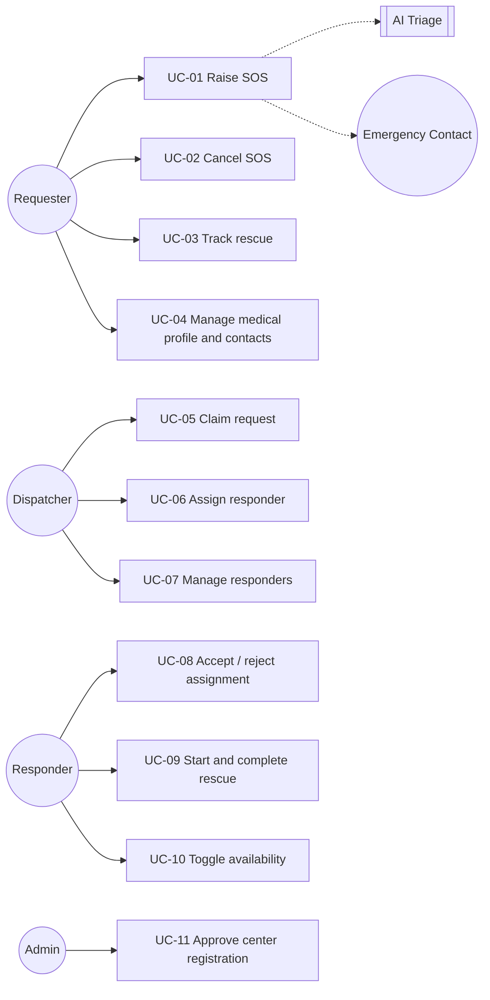

# Software Requirements Specification (SRS)

Version 1.0 · 2026-10-31 · Status: Proposed

## 1. Scope

SOS App lets a person in distress send a rescue request with their location in seconds, automatically routes the request to the nearest suitable rescue center, and lets the center assign a responder and track the rescue to completion.

**In scope for v1:** Android mobile app (iOS if a test device is available), Firebase backend, AI incident classification, push notifications and SMS.

**Out of scope for v1:** direct integration with the 113/114/115 hotlines (the app only suggests calling), payments, a full web dashboard for centers (only a minimal admin to approve registrations), languages other than Vietnamese and English.

## 2. Actors

| Actor | Description | Current code |
| --- | --- | --- |
| Requester | End user who raises an SOS | role `user` |
| Responder | Belongs to a center, receives assignments and goes to the scene | role `worker` |
| Center Dispatcher | Account of a rescue center; receives requests and assigns responders | role `center` |
| Admin | Approves center registrations, handles abuse | not present |
| Emergency Contact | Relative who receives an SMS; does not install the app | not present |
| AI Triage | External system (Claude API) that classifies incidents | not present |

## 3. Main use cases

## 4. Functional requirements (FR)

MoSCoW priority: **M** = Must, **S** = Should, **C** = Could.

### 4.1 SOS (Emergency Request)

| ID | Requirement | Priority | Current state |
| --- | --- | --- | --- |
| SOS-01 | Requester raises an SOS by holding a button for 3 seconds; a 5-second countdown allows cancelling before sending | M | Missing (must fill a form) |
| SOS-02 | SOS attaches the latest GPS fix (accuracy ≤ 50 m when available) and never uses a cached location older than 2 minutes | M | Uses cache, age not checked |
| SOS-03 | Requester can add incident type, description and up to 3 photos after sending | S | Required before sending, no photos |
| SOS-04 | A requester has at most one active request | M | Not enforced |
| SOS-05 | Requester can cancel a request that is not yet `IN_PROGRESS` | M | Deletes the document directly |
| SOS-06 | When offline, the request is queued and retried automatically; 113/114/115 call buttons are shown | S | Missing |
| SOS-07 | Requester sees request status in real time | M | Present |

### 4.2 Dispatch

| ID | Requirement | Priority | Current state |
| --- | --- | --- | --- |
| DSP-01 | Find available centers within 10 km, expanding to 20 km then 50 km if none, independent of province/city names | M | Filters by `city`, then fixed 10 km |
| DSP-02 | Notify at most the 5 nearest centers at once | M | Notifies all |
| DSP-03 | Only one center can claim a request; later centers are told "already claimed" | M | No claim; several centers can assign |
| DSP-04 | If no center claims within 3 minutes (configurable), the request becomes `EXPIRED` and the requester is notified with emergency numbers | M | 10-minute `setTimeout` never fires |
| DSP-05 | Dispatcher assigns an `AVAILABLE` responder of their own center | M | Present, no permission check |
| DSP-06 | If the responder does not respond within 60 seconds or rejects, the request returns to awaiting assignment and the dispatcher is notified | M | `setTimeout` never fires; reject query is broken |
| DSP-07 | Severity ≥ 4 (from AI or requester) expands the radius immediately and sends high-priority push | S | Missing |

### 4.3 Rescue execution and location tracking

| ID | Requirement | Priority | Current state |
| --- | --- | --- | --- |
| DSP-08 | When the responder accepts, the request becomes `IN_PROGRESS` and shows route and ETA | M | Present |
| DSP-09 | Responder marks the rescue complete; requester can confirm or give feedback | M | Either side marks complete on their own |
| TRK-01 | Requester and responder locations update every 10 to 15 seconds while the request is active, and stop when it ends | S | Only the location at creation |
| TRK-02 | Record distance and duration of each rescue for statistics | C | Partial (double-counted when triggers retry) |

### 4.4 AI Triage

| ID | Requirement | Priority |
| --- | --- | --- |
| TRI-01 | Classify incidents into `TRAFFIC_ACCIDENT`, `FIRE`, `MEDICAL`, `DROWNING`, `NATURAL_DISASTER`, `CRIME`, `OTHER` | S |
| TRI-02 | Assess severity 1 to 5 with a confidence score | S |
| TRI-03 | Produce a one-sentence summary for the dispatcher and 3 to 5 first-aid steps for the requester | S |
| TRI-04 | AI must never block, delay, or lower the priority of a request | M (constraint) |
| TRI-05 | Dispatcher can override the AI labels; overrides are stored for evaluation | C |

### 4.5 Profile

| ID | Requirement | Priority | Current state |
| --- | --- | --- | --- |
| PRF-01 | Sign up with phone number (OTP) or Google | M | Present |
| PRF-02 | Medical profile: blood type, allergies, conditions, current medications, notes | M | Missing |
| PRF-03 | Up to 5 emergency contacts (name, phone, relationship) | M | Missing |
| PRF-04 | The medical profile is visible only to the responder and dispatcher handling that person's active request | M | Missing |

### 4.6 Notification

| ID | Requirement | Priority |
| --- | --- | --- |
| NTF-01 | FCM push for every state change relevant to the recipient | M |
| NTF-02 | In-app inbox with read/unread state | S |
| NTF-03 | Never send duplicate notifications for the same event | M |
| NTF-04 | SMS with a Google Maps link to emergency contacts when an SOS is raised | S |

### 4.7 Centers and responders

| ID | Requirement | Priority | Current state |
| --- | --- | --- | --- |
| CTR-01 | A center registers (name, address, location, license) and waits for admin approval | M | Present, but self-approvable because rules are open |
| CTR-02 | Dispatcher creates and disables responder accounts of their own center | M | Endpoint has no authentication |
| CTR-03 | Center availability is derived from the number of `AVAILABLE` responders | M | Present, drifts easily |
| CTR-04 | Per-center statistics: number of rescues, mean response time | C | Partial |

### 4.8 Authentication and authorization

| ID | Requirement | Priority |
| --- | --- | --- |
| AUT-01 | Roles (`requester`, `responder`, `dispatcher`, `admin`) live in custom claims; clients cannot change them | M |
| AUT-02 | Every business state change goes through a Callable Function that checks role and ownership | M |
| AUT-03 | Firebase App Check enabled for Functions and Firestore | S |

## 5. Non-functional requirements (NFR)

| ID | Category | Measurable requirement |
| --- | --- | --- |
| NF-01 | Latency | From requester pressing send to center receiving the push: p95 < 5 seconds (on 4G) |
| NF-02 | AI latency | Triage result p95 < 8 seconds; skipped beyond 8 seconds |
| NF-03 | Reliability | No accepted SOS request is lost; every timer (expiry, timeout) fires within ±10 seconds |
| NF-04 | Correctness | Never two centers claiming one request; never a responder with two active assignments |
| NF-05 | Security | No secrets in the repo; every collection has rules and rule tests; secret scanning in CI |
| NF-06 | Privacy | Comply with Vietnam's Decree 13/2023/ND-CP on personal data protection: explicit consent before collecting medical data; account and data deletion |
| NF-07 | AI privacy | Never send name, phone number or national ID to AI; photos and medical data only with consent |
| NF-08 | Availability | Bound by Firebase SLA; the app always shows emergency numbers when the backend fails |
| NF-09 | Battery | Continuous location tracking only while a request is active |
| NF-10 | Maintainability | Domain coverage ≥ 90%; clean lint and typecheck; every PR has tests |
| NF-11 | Observability | Structured logs with `requestId`; alert when function error rate > 1% over 5 minutes |
| NF-12 | Cost | Under USD 10 per month at demo scale (≤ 1,000 requests) |

## 6. Sample acceptance criteria

**SOS-01 + SOS-02**
- Given the requester is signed in and has granted location permission
- When they hold the SOS button for 3 seconds and do not cancel during the 5-second countdown
- Then a `RescueRequest` in `PENDING` is created with a location whose `capturedAt` is no older than 2 minutes, and the screen switches to tracking.

**DSP-03**
- Given a `PENDING` request that notified centers A and B
- When A and B both press "Claim" within 100 ms
- Then exactly one center succeeds and the other receives `ALREADY_CLAIMED`.

**DSP-04**
- Given a `PENDING` request that no center claims
- When 3 minutes pass
- Then the request becomes `EXPIRED`, the requester gets a push with a "Call 115" button, and the requester is released from the active-request lock.

**TRI-04**
- Given the Claude API errors or takes longer than 8 seconds
- When a request is created
- Then dispatch proceeds exactly as with AI disabled and the request has no `triage` field.

## 7. Assumptions and open questions

- Assumption: rescue centers use the mobile app (dispatcher role); no web dashboard is needed yet.
- Question: should "independent" responders (volunteers not attached to a center) be supported? This affects the Responder domain model.
- Question: which SMS provider (Twilio, eSMS.vn, SpeedSMS)? This affects cost and sender branding.
- Question: does the app need to run on iOS for the demo?
