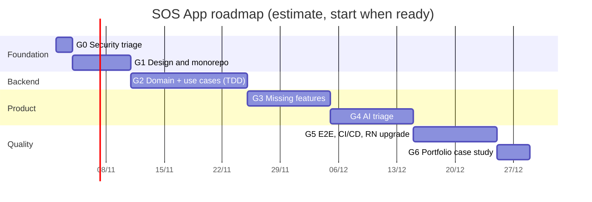

# SOS App Refactor Roadmap

**Goal:** turn SOS App from a working graduation project into a secure, tested, documented system that stands up as a real-world project in a portfolio.

**Estimate:** 7 to 10 weeks part-time (about 15 to 20 hours per week), in 7 phases. G0 starts immediately; later phases run in order because each depends on the previous one.

## 1. Current state summary (2026-10-31)

| Area | Current state | Risk |
| --- | --- | --- |
| Firestore rules | `allow read, write: if true` | Critical |
| Secrets in git | Admin service account key, `google-services.json`, `debug.keystore` | Critical |
| REST API | `POST /users/new-worker` has no authentication | Critical |
| Business logic | Client writes state directly; server only reacts through triggers | High |
| Request expiry | `setTimeout` inside triggers, never fires | High |
| Error handling | 11 empty `catch {}` blocks in the app; every trigger swallows errors | High |
| Tests / CI | One default template test, no CI | High |
| Original requirements | Missing medical profile, emergency contacts, one-tap SOS | Medium |
| Versions | React Native 0.71, Node 18, firebase-functions v4 (v1 API) | Medium |

## 2. Phases

### G0. Security triage (1 to 2 days)

No need to wait for the new design. Done on the current code.

- [ ] Revoke service account key `firebase-adminsdk-qd8q5` in GCP IAM, delete the file from the repo, switch to parameterless `admin.initializeApp()`.
- [ ] If the GitHub repo is public: purge the file from history with `git filter-repo`, then force push.
- [ ] Temporary Firestore rules: allow only `request.auth != null`.
- [ ] Add an auth check (verify ID token) to `POST /users/new-worker`, or disable the endpoint.
- [ ] Restrict the Google Maps API key by package name + SHA-1 and by API.
- [ ] Add `.gitattributes` (`* text=auto eol=lf`), `.env.example`, update `.gitignore`.

**Definition of Done:** no secrets in the working tree; unauthenticated Firestore access is denied (verified with a REST call without a token).

### G1. Design and monorepo skeleton (1 week)

- [ ] Review and finalize these docs: requirements, domain model, HLD, LLD, ADRs (status `Proposed` → `Accepted`).
- [x] Create the monorepo per [ADR-0008](../04-adr/0008-monorepo-shared-contracts.md): `apps/mobile`, `services/api`, `packages/contracts` (done 2026-10-31; `packages/domain` comes with the first aggregate in G2).
- [ ] Scaffold the NestJS API ([ADR-0011](../04-adr/0011-nestjs-api-replaces-cloud-functions.md)): Firebase ID token guard, health checks, config validation, Docker image (done); Redis + BullMQ; retire `server/functions`.
- [ ] Minimal CI: lint, typecheck, unit tests for every package.
- [ ] Local stack starts with one command (`pnpm dev`): API, Redis, Firestore + Auth emulators.
- [ ] Firebase projects on the Spark plan (no Functions needed): `sos-dev` now; `sos-staging`, `sos-prod` in G5. Render service + Redis for the API.

**DoD:** `pnpm test` is green on CI with empty test suites in every package; docs are `Accepted`.

### G2. Domain and use cases with TDD (2 weeks)

Rewrite all business logic in `packages/domain` (pure TypeScript, no Firebase dependency), then connect it to Firebase through adapters.

- [ ] `RescueRequest` aggregate with the full state machine (LLD §3) and invariants INV-01..INV-08.
- [ ] `Assignment`, `RescueCenter`, `Responder` aggregates.
- [ ] `CenterMatchingPolicy` domain service (geohash, expanding radius).
- [ ] Command handlers: `RaiseSos`, `CancelSos`, `ClaimRequest`, `AssignResponder`, `AcceptAssignment`, `RejectAssignment`, `StartRescue`, `CompleteRescue`, `ExpireRequest`, `TimeoutAssignment`.
- [ ] Adapters: Firestore repositories (transaction + optimistic version), FCM notifier, BullMQ scheduler ([ADR-0012](../04-adr/0012-durable-timers-bullmq.md)).
- [ ] REST command endpoints replace direct client writes; custom claims for roles ([ADR-0002](../04-adr/0002-server-authoritative-commands.md), [ADR-0004](../04-adr/0004-roles-via-custom-claims.md)).
- [ ] Real Firestore rules, each with a test ([LLD §7](../03-design/lld.md#7-firestore-security-rules)).
- [ ] App switches to the API client; remove every client write to `status`.
- [ ] Migration script for old data (`messages`, `assigns`, `users`) to the new schema.

**DoD:** every test case in [test-strategy §6](../05-testing/test-strategy.md#6-seed-test-case-catalog-tdd) is green; `packages/domain` coverage ≥ 90% lines, ≥ 85% branches; clients can no longer write state fields.

### G3. Complete the original requirements (1.5 weeks)

- [ ] SOS-01 one-tap SOS (hold 3 seconds, countdown, cancellable).
- [ ] PRF-02 medical profile, PRF-03 emergency contacts, NTF-04 SMS to relatives.
- [ ] TRK-01 live location for requester and responder.
- [ ] SOS-06 offline queue and 113/114/115 call buttons.
- [ ] Clear error messages for every action (remove all empty `catch {}`).

**DoD:** the matching acceptance criteria in requirements all have passing tests.

### G4. AI triage (1.5 weeks)

Per [ADR-0007](../04-adr/0007-ai-triage-advisory.md) and [LLD §8](../03-design/lld.md#8-ai-triage).

- [ ] `TriageModel` port + Claude API adapter, output validated with zod.
- [ ] Eval set of 50 to 100 labelled scenarios, measuring per-category accuracy and the under-triage rate for severe cases.
- [ ] UI: severity badge for dispatchers, first-aid guidance for requesters, override button.
- [ ] Fall detection via accelerometer (optional).

**DoD:** under-triage rate (true severity 4 to 5 scored ≤ 2 by AI) is 0 on the eval set; triage p95 < 8 seconds; dispatch is unaffected when AI is disabled.

### G5. E2E, CI/CD, platform upgrade (1.5 weeks)

- [ ] Upgrade React Native to the current release (New Architecture) and RN Firebase; consider an Expo dev client.
- [ ] Maestro E2E for the 3 main flows ([test-strategy §6.6](../05-testing/test-strategy.md#66-e2e-maestro)).
- [ ] GitHub Actions: deploy the API to Render staging and Firestore rules to `sos-staging` on merge to `main`, to production on tag; build a release-signed APK; keep-warm ping.
- [ ] Crashlytics, function error alerts, dispatch latency dashboard.

**DoD:** pipeline is green from PR to staging automatically; a `v1.0.0` tag deploys to prod.

### G6. Portfolio (3 to 4 days)

- [ ] New README: diagrams, demo GIF, how to run on the emulator.
- [ ] Portfolio case study: Problem → Challenge → Solution → Result, highlighting the state machine, transactions against race conditions, durable BullMQ timers, escalate-only AI.

## 3. Plan risks

| Risk | Likelihood | Impact | Mitigation |
| --- | --- | --- | --- |
| Upgrading RN 0.71 breaks many native libraries | High | 1 to 2 weeks late | Do it in G5, after tests exist; consider Expo |
| Old data does not fit the new schema | Medium | Demo data lost | Migration script with dry-run; export Firestore first |
| Claude API / Maps costs exceed estimate | Low | Money | Per-user rate limits, GCP budget alerts |
| No iOS device for testing | Medium | Android-only demo | State Android-first scope in README |
