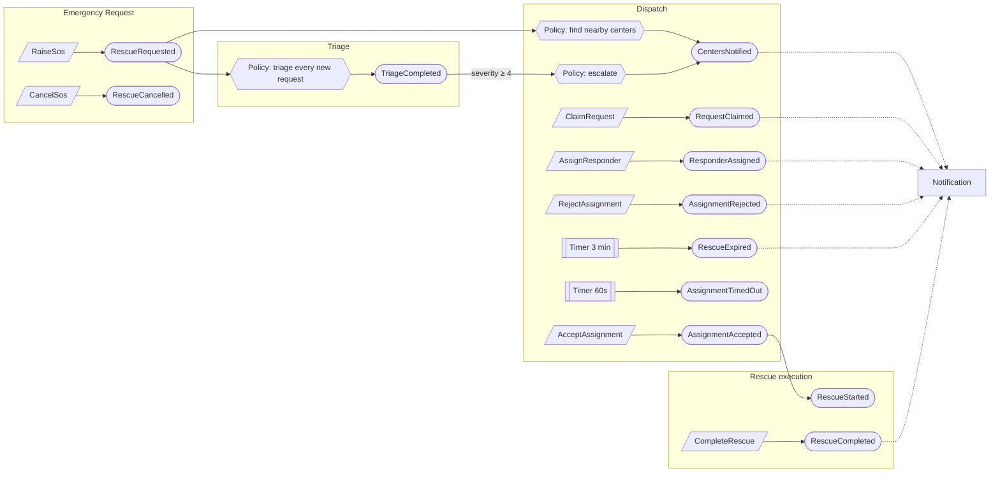
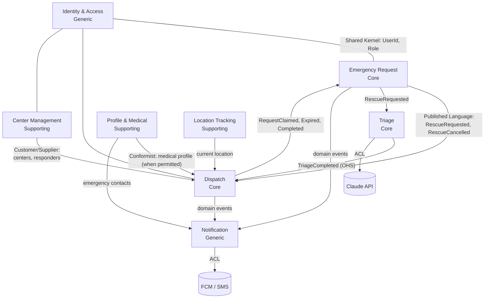
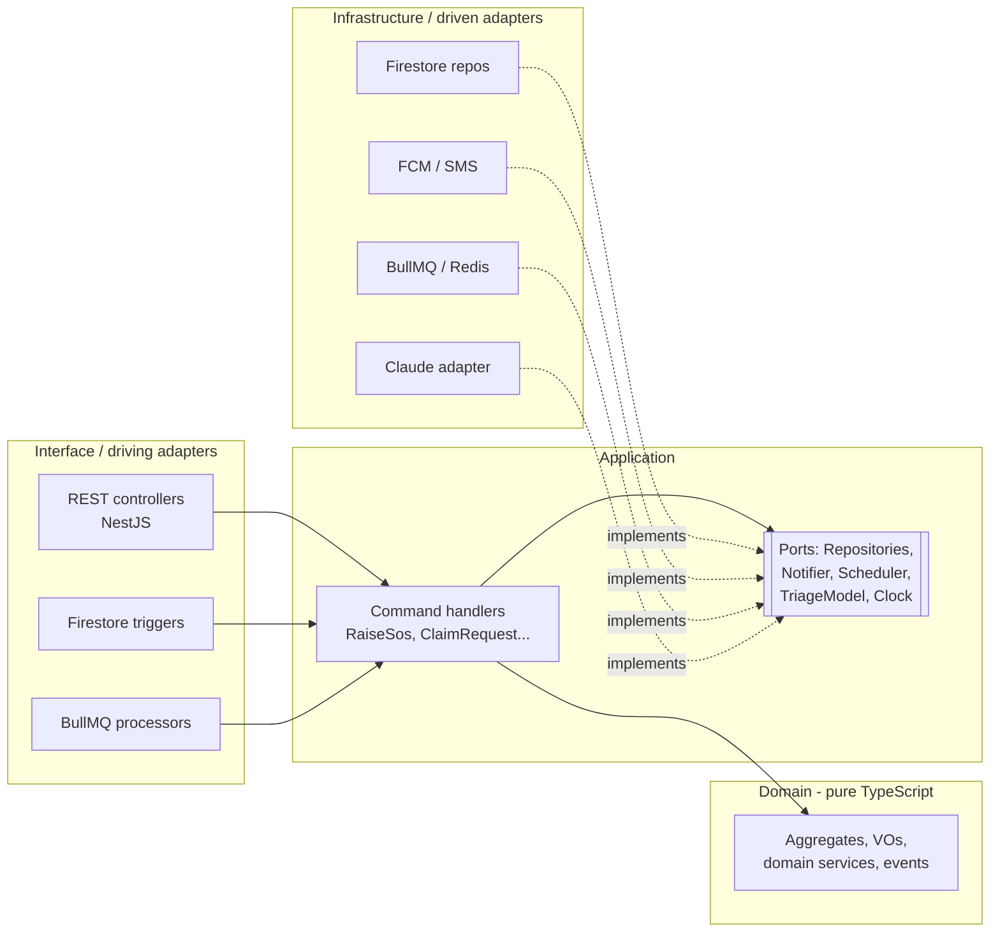

# Domain Model (DDD)

Version 1.0 · 2026-10-31 · Status: Proposed

This document has two parts: **strategic design** (splitting the system into bounded contexts and how they relate) and **tactical design** (aggregates, entities, value objects, domain events and invariants inside each context). The Event Storming output in §3 is the source for both.

## 1. Ubiquitous Language

Code, docs, UI and conversations use the terms below. The "Old name" column is what the current code uses and will be replaced.

| Term | Name in code | Old name | Definition |
| --- | --- | --- | --- |
| Rescue request | `RescueRequest` | `message` | One SOS by a requester, with a lifecycle from `PENDING` to a terminal state |
| Requester | `Requester` | `user` | The person who raises a rescue request |
| Rescue center | `RescueCenter` | `center` (in `users`) | An admin-approved organization with dispatchers and responders |
| Dispatcher | `Dispatcher` | `center` | Account acting on behalf of a center |
| Responder | `Responder` | `worker` | Person who goes to the scene |
| Claim | `claim` | (none) | A center taking ownership of a request; only one center may claim |
| Assignment | `Assignment` | `assign` | An offer of work from a center to one responder for one request |
| Available | `AVAILABLE` | `free`, `available` | Responder can take work / center has a free responder |
| On mission | `ON_MISSION` | `busy` | Responder has an active assignment |
| Off duty | `OFF_DUTY` | `unavailable` | Responder is not taking work |
| Expired | `EXPIRED` | `expired` | No center claimed the request in time |
| Triage assessment | `TriageAssessment` | (none) | AI result: incident category, severity, summary, first aid |
| Severity | `Severity` | (none) | Integer from 1 (minor) to 5 (life-threatening) |
| Search radius | `SearchRadius` | fixed 10000 | Radius for finding centers, expanding in steps of 10 / 20 / 50 km |
| Medical profile | `MedicalProfile` | (none) | Sensitive medical information of a requester |
| Emergency contact | `EmergencyContact` | (none) | Relative who receives an SMS when an SOS is raised |

## 2. Subdomain classification

| Subdomain | Type | Reason | Investment |
| --- | --- | --- | --- |
| Emergency Request | **Core** | Core value: fast, correct, never-lost SOS | Build in-house, full DDD, TDD |
| Dispatch | **Core** | Product differentiator: right center, no contention bugs | Build in-house, full DDD, TDD |
| Triage (AI) | **Core** (decision support) | Improves dispatch quality; portfolio highlight | Build the domain layer, buy the model (Claude) |
| Center Management | Supporting | Needed but not differentiating | Build, CRUD + rules |
| Profile & Medical | Supporting | Needed, data-sensitive | Build, focus on security |
| Location Tracking | Supporting | Infrastructure for tracking | Thin build on libraries |
| Notification | Generic | Common problem | FCM + SMS provider |
| Identity & Access | Generic | Common problem | Firebase Auth + custom claims |

## 3. Event Storming (Big Picture)

Timeline of one rescue, read left to right. Stadium shapes are domain events, parallelograms are commands, hexagons are policies, double boxes are timers.

**Hotspots found during storming**

1. Two centers claiming the same request: needs a `ClaimRequest` command with a single-owner invariant (INV-02).
2. Timers that run after the function has returned: needs durable scheduling outside the function (ADR-0005).
3. Who may mark a rescue complete: the responder completes, the requester only confirms (DSP-09).
4. Slow AI slowing down SOS: triage runs in parallel and can only escalate (ADR-0007).

## 4. Bounded contexts and Context Map

| Relationship | Type | Notes |
| --- | --- | --- |
| Emergency Request → Dispatch | Published Language (domain events) | Dispatch never reads Request internals directly |
| Triage → Claude | Anti-Corruption Layer | Prompts, model ids and Claude's JSON format never leak into the domain |
| Notification → FCM/SMS | Anti-Corruption Layer | The domain only knows the `Notifier` port |
| Center Management → Dispatch | Customer/Supplier | Dispatch is the customer; it needs centers queried by location |
| Identity → every context | Small Shared Kernel | Only `UserId`, `Role`, `Actor` |

**Deployment grouping:** at the current scale, Emergency Request and Dispatch ship in one deployable (`services/api`, NestJS) but live in separate packages/folders and communicate only through domain events, so they can be split later.

## 5. Tactical design

### 5.1 Emergency Request + Dispatch

**Aggregate `RescueRequest`** (aggregate root)

| Member | Type | Notes |
| --- | --- | --- |
| `id` | `RescueRequestId` (VO) | |
| `requesterId` | `UserId` (VO) | |
| `status` | `RequestStatus` (VO, enum) | see the state machine in LLD §3 |
| `location` | `GeoPoint` (VO) | lat, lng, accuracyM, capturedAt |
| `category` | `IncidentCategory` (VO) | chosen by requester or suggested by AI |
| `severity` | `Severity` (VO) | `max(requesterSeverity, triageSeverity)` |
| `description` | `string` | ≤ 1000 characters |
| `attachments` | `AttachmentRef[]` | ≤ 3 photos |
| `claimedBy` | `CenterId?` | |
| `activeAssignmentId` | `AssignmentId?` | |
| `searchRadius` | `SearchRadius` (VO) | 10 / 20 / 50 km |
| `notifiedCenters` | `CenterId[]` | |
| `triage` | `TriageSnapshot?` (VO) | copy of the AI result |
| `timeline` | `TimelineEntry[]` | history of state transitions |
| `version` | `number` | optimistic concurrency |

**Aggregate `Assignment`**: `id`, `requestId`, `centerId`, `responderId`, `status` (`OFFERED`, `ACCEPTED`, `REJECTED`, `TIMED_OUT`, `COMPLETED`, `CANCELLED`), `offeredAt`, `respondedAt`, `version`.

`Assignment` is separate from `RescueRequest` because it has its own lifecycle (one request may go through several assignments after rejections/timeouts) and its own invariants with the responder.

**Aggregate `Responder`**: `id` (= UserId), `centerId`, `availability` (`AVAILABLE`, `ON_MISSION`, `OFF_DUTY`), `currentAssignmentId?`, `disabled`, `stats` (`missions`, `totalDistanceM`, `totalDurationS`), `version`.

**Aggregate `RescueCenter`** (owned by Center Management; Dispatch reads it through a read model): `id`, `name`, `location`, `geohash`, `registrationStatus` (`PENDING`, `APPROVED`, `REJECTED`, `SUSPENDED`), `availableResponders` (count, a read model updated from events), `dispatcherIds`.

**Value objects**

- `GeoPoint` validates lat ∈ [-90, 90], lng ∈ [-180, 180]; has `isFresh(now, maxAge)`.
- `Severity` accepts only 1..5; `escalate(other)` returns the larger value and never decreases.
- `SearchRadius` has `next()`: 10 → 20 → 50 → `null` (no more steps).
- `IncidentCategory` is a closed enum; external strings are mapped through the ACL.

**Domain services**

- `CenterMatchingPolicy.findCandidates(location, radius, limit=5)`: returns `APPROVED` centers with `availableResponders > 0`, sorted by distance. Depends on the `CenterDirectory` port.
- `DispatchEscalationPolicy`: decides when to expand the radius (severity ≥ 4, or a radius step timed out).

### 5.2 Invariants

| ID | Invariant | Enforced by |
| --- | --- | --- |
| INV-01 | A requester has at most one `RescueRequest` in an active state (`PENDING`, `CLAIMED`, `ASSIGNED`, `IN_PROGRESS`) | `RaiseSos` use case + lock document `activeRequests/{requesterId}` in a transaction |
| INV-02 | A `RescueRequest` is claimed by at most one center | `RescueRequest.claim()` + transaction |
| INV-03 | A `RescueRequest` has at most one `Assignment` in `OFFERED` or `ACCEPTED` | `RescueRequest.assign()` |
| INV-04 | A `Responder` has at most one active assignment; only `AVAILABLE`, non-`disabled` responders of the same center can be assigned | `Responder.reserve()` in the same transaction as `assign()` |
| INV-05 | State changes follow only the edges of the state machine; terminal states never change | `RescueRequest.transition()` |
| INV-06 | `Severity` can only increase | VO `Severity.escalate()` |
| INV-07 | Only the owning requester can cancel; only the assigned responder can start/complete | Use cases check the `Actor` |
| INV-08 | A medical profile is readable only by its owner and the participants of that owner's active request | Firestore rules + `GetMedicalProfileForRescue` use case |

### 5.3 Domain events

Every event carries `eventId` (UUID), `occurredAt`, `aggregateId`, `version`. Events are immutable and named in the past tense.

| Event | Emitted by | Listeners |
| --- | --- | --- |
| `RescueRequested` | RescueRequest | Triage, Dispatch, Notification (SMS to relatives) |
| `TriageCompleted` | TriageAssessment | Dispatch (escalation), RescueRequest (severity update) |
| `CentersNotified` | RescueRequest | Notification |
| `SearchRadiusExpanded` | RescueRequest | Dispatch |
| `RequestClaimed` | RescueRequest | Notification (tell the requester and the other centers) |
| `ResponderAssigned` | Assignment | Notification, Scheduler (60-second timer) |
| `AssignmentAccepted` | Assignment | RescueRequest (`IN_PROGRESS`), Tracking (start) |
| `AssignmentRejected` / `AssignmentTimedOut` | Assignment | RescueRequest (back to `CLAIMED`), Responder (release), Notification |
| `RescueCompleted` | RescueRequest | Responder (release, add stats), Tracking (stop), Notification |
| `RescueCancelled` | RescueRequest | Assignment (cancel), Responder (release), Notification |
| `RescueExpired` | RescueRequest | Notification |
| `ResponderAvailabilityChanged` | Responder | Center read model (`availableResponders`) |
| `CenterApproved` | RescueCenter | Notification |

### 5.4 Profile & Medical

- Aggregate `UserProfile`: `id`, `displayName`, `phone`, `role`, `fcmTokens[]`, `consents` (`medicalDataSharing`, `aiProcessing`, `photoSharing`, each with a timestamp).
- Aggregate `MedicalProfile` (separate because it is sensitive; stored in a private subcollection): `bloodType`, `allergies[]`, `conditions[]`, `medications[]`, `notes`, `updatedAt`.
- Entity `EmergencyContact` (owned by `UserProfile`, at most 5): `name`, `phone` (E.164), `relationship`.

### 5.5 Triage

- Aggregate `TriageAssessment`: `requestId`, `category`, `severity`, `confidence`, `summary`, `firstAid[]`, `needs[]` (`AMBULANCE_115`, `FIRE_114`, `POLICE_113`), `model`, `promptVersion`, `latencyMs`, `overriddenBy?`, `overriddenCategory?`, `overriddenSeverity?`.
- Port `TriageModel.assess(input): Promise<TriageResult>`; adapter `ClaudeTriageModel` is the ACL.
- Policy: `TriageCompleted` can only raise `RescueRequest.severity` (INV-06).

## 6. Architecture inside each context (Hexagonal)

Dependency rule: `domain` imports nothing but standard TypeScript; `application` imports only `domain` and defines ports; `infrastructure` and `interface` import both. The rule is enforced with `eslint-plugin-boundaries` in CI.
