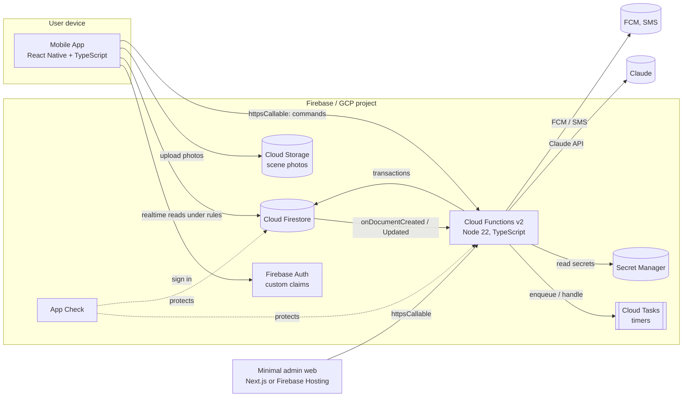
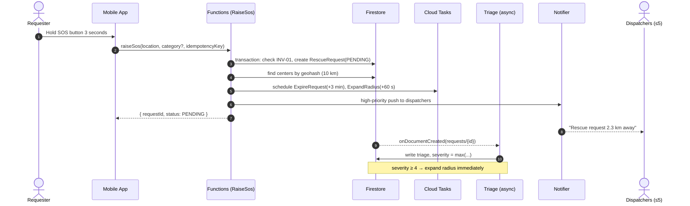
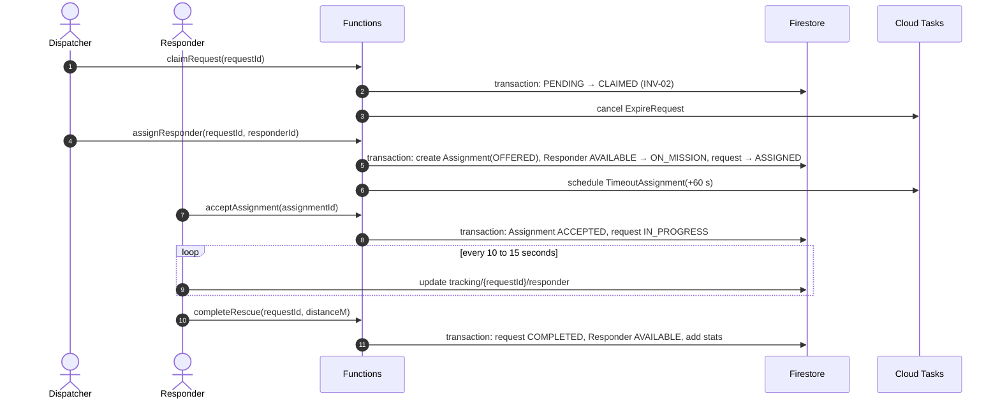
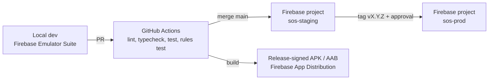

# High-Level Design (HLD)

Version 1.0 · 2026-10-31 · Status: Proposed

## 1. Design goals

1. **Server-authoritative:** the backend decides every business state change; clients only send intents (commands) and read data ([ADR-0002](../04-adr/0002-server-authoritative-commands.md)).
2. **Correct under contention:** Firestore transactions for every invariant spanning several documents (NF-04).
3. **Durable timers:** expiry and timeouts use Cloud Tasks, never function memory ([ADR-0005](../04-adr/0005-durable-timers-cloud-tasks.md)).
4. **Pure, testable domain:** business logic lives in a TypeScript package with no Firebase dependency ([ADR-0003](../04-adr/0003-hexagonal-ddd-in-functions.md)).
5. **Advisory AI:** triage runs in parallel, is skipped on failure, and can only escalate ([ADR-0007](../04-adr/0007-ai-triage-advisory.md)).
6. **Stay on Firebase** for realtime, auth, push and low cost ([ADR-0001](../04-adr/0001-keep-firebase-serverless.md)).

## 2. As-is vs to-be

| Aspect | As-is | To-be |
| --- | --- | --- |
| Business writes | Client writes Firestore directly | Client calls Callable Functions; rules block writes to business fields |
| Backend logic | One 600-line `index.js`, reactive triggers | Hexagonal: domain / application / infrastructure / interface |
| Roles | `role` field written by the client | Firebase Auth custom claims |
| Timers | `setTimeout` | Cloud Tasks (`onTaskDispatched`) |
| Center search | `city` filter + fixed 10 km | Geohash query, 10 / 20 / 50 km radius |
| User data | One `users` collection for every role | `users`, `centers`, `responders`, `users/{id}/private/medical` |
| Environments | One project, hardcoded LAN IP | `dev` / `staging` / `prod`, config via `.env` and Secret Manager |
| Tests / CI | None | TDD, emulator, GitHub Actions |

## 3. System Context (C4 level 1)

## 4. Containers (C4 level 2)

| Container | Technology | Responsibility | Does not |
| --- | --- | --- | --- |
| Mobile App | React Native (current release), React Navigation, RN Firebase, react-native-maps | Role-based UI, sends commands, listens to Firestore, sends location during a rescue | Write state fields; call Claude or server-side Maps APIs |
| Cloud Functions | firebase-functions v2, TypeScript | Callable commands, projection triggers, task handlers, external calls | Hold state in memory |
| Firestore | Native mode, region `asia-southeast1` | Source of truth for aggregates, read models for UI | |
| Cloud Tasks | Queue `rescue-timers` | Request expiry, assignment timeout, radius expansion | |
| Cloud Storage | Default bucket | Scene photos, rules keyed by requestId | |
| Admin web | Small, optional | Approve centers, set custom claims | |

## 5. Main flows (high level)

### 5.1 Raise SOS and dispatch

### 5.2 Claim, assign, execute

## 6. Data (high level)

| Collection | Aggregate / role | Readers | Writers |
| --- | --- | --- | --- |
| `requests/{id}` | RescueRequest | Owning requester, notified/claiming centers, assigned responder | Functions only |
| `requests/{id}/timeline/{eventId}` | State transition history | Same as above | Functions only |
| `assignments/{id}` | Assignment | Center dispatchers, assigned responder | Functions only |
| `centers/{id}` | RescueCenter | Any signed-in user (public info) | Functions; dispatchers edit descriptive fields |
| `responders/{uid}` | Responder | The responder, dispatchers of the same center | Functions only |
| `users/{uid}` | UserProfile | Owner | Owner (except `role`, `fcmTokens` via functions) |
| `users/{uid}/private/medical` | MedicalProfile | Owner; active-rescue participants (via function) | Owner |
| `tracking/{requestId}` | Live location | Rescue participants | Requester / responder of the rescue, own field only |
| `notifications/{id}` | Inbox | Recipient | Functions; recipient edits `readAt` only |
| `activeRequests/{requesterId}` | INV-01 lock | Nobody (internal) | Functions only |
| `processedEvents/{eventId}` | Idempotency | Nobody | Functions only |

Field-level detail, indexes and rules: [LLD §2](lld.md#2-firestore-schema).

## 7. Deployment

- Region: `asia-southeast1` (Singapore) for Functions, Firestore and Cloud Tasks, for low latency to Vietnam.
- Secrets (Claude API key, SMS key): Secret Manager, declared with `defineSecret`. No key files in the repo.
- App config per environment: `react-native-config` with `.env.dev`, `.env.staging`, `.env.prod` (not committed, `.env.example` provided); `google-services.json` injected by CI from a secret.
- Functions: min instances = 1 for `raiseSos` in prod to avoid cold starts (NF-01); 0 for the rest.

## 8. Security

| Layer | Measures |
| --- | --- |
| Identity | Firebase Auth (phone OTP, Google); custom claims `role`, `centerId` |
| Application | App Check (Play Integrity) for Functions and Firestore |
| Data | Deny-by-default rules; only Functions write business fields; every rule has a test |
| Secrets | Secret Manager; `gitleaks` secret scanning in CI |
| Client API keys | Maps key restricted by package + SHA-1 and by API; Distance Matrix / Geocoding called through Functions |
| Medical data | Private subcollection, shared only with consent during an active rescue; no identity sent to AI |
| Abuse | Rate limit `raiseSos` to 3 per 10 minutes per user; fake SOS reporting |

## 9. Quality attributes and tactics

| NFR | Architectural tactic |
| --- | --- |
| NF-01 latency | Send push directly inside `raiseSos`, not via a trigger; min instance; nearby region |
| NF-03 reliability | Callables take an `idempotencyKey`; Cloud Tasks retries; triggers idempotent via `processedEvents` |
| NF-04 correctness | Transactions + `version`; invariants inside aggregates; contention tests on the emulator |
| NF-07 AI privacy | ACL strips data before sending; logs contain no PII |
| NF-11 observability | `logger` with `requestId`, `eventId`; Cloud Monitoring alerts; Crashlytics for the app |
| NF-12 cost | Bounded Firestore listener queries; small model for text-only triage; budget alerts |

## 10. Technical risks

| Risk | Mitigation |
| --- | --- |
| Cold starts slow down SOS | Min instances for `raiseSos`; keep the bundle small |
| Transaction contention when many centers claim at once | Only one document is contended (`requests/{id}`); SDK auto-retry; at most 5 centers |
| Cloud Tasks delivers twice | Idempotent handlers: check current state before transitioning |
| Poor indoor GPS accuracy | Show accuracy; let the requester adjust the pin on the map |
