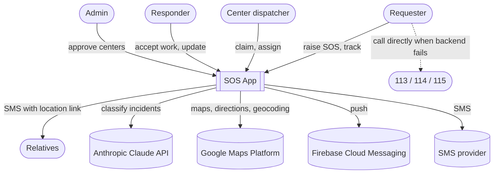
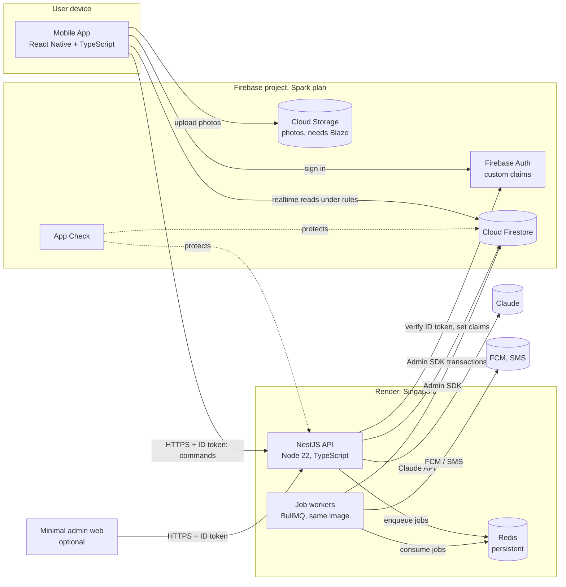
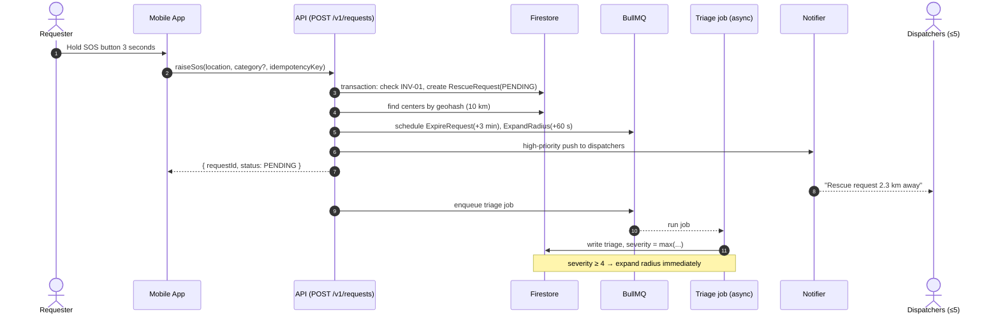
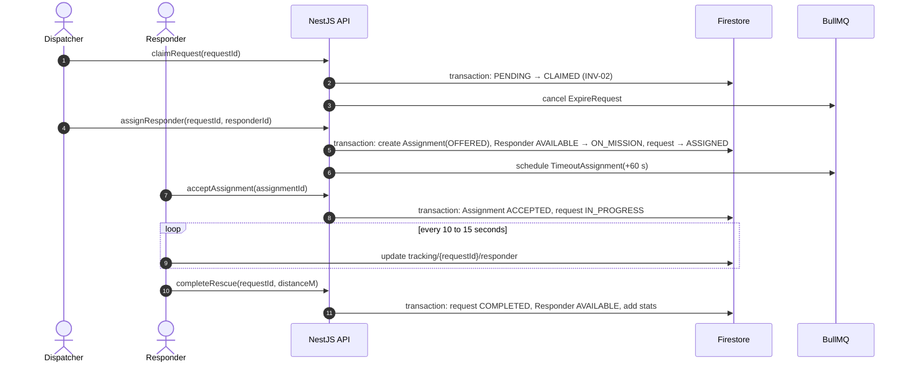
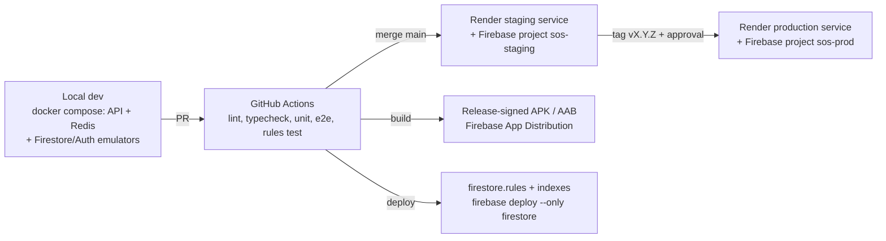

# High-Level Design (HLD)

Version 1.0 · 2026-10-31 · Status: Proposed

## 1. Design goals

1. **Server-authoritative:** the NestJS API decides every business state change; clients only send intents (commands) over HTTP and read data from Firestore ([ADR-0002](../04-adr/0002-server-authoritative-commands.md), [ADR-0011](../04-adr/0011-nestjs-api-replaces-cloud-functions.md)).
2. **Correct under contention:** Firestore transactions for every invariant spanning several documents (NF-04).
3. **Durable timers:** expiry and timeouts use BullMQ delayed jobs on Redis, never process memory ([ADR-0012](../04-adr/0012-durable-timers-bullmq.md)).
4. **Pure, testable domain:** business logic lives in a TypeScript package with no Firebase dependency ([ADR-0003](../04-adr/0003-hexagonal-ddd-in-functions.md)).
5. **Advisory AI:** triage runs in parallel, is skipped on failure, and can only escalate ([ADR-0007](../04-adr/0007-ai-triage-advisory.md)).
6. **Keep Firebase for data, auth and push** (Firestore realtime, Firebase Auth, FCM) behind a NestJS API ([ADR-0013](../04-adr/0013-firestore-as-data-store.md)).

## 2. As-is vs to-be

| Aspect | As-is | To-be |
| --- | --- | --- |
| Business writes | Client writes Firestore directly | Client calls the NestJS REST API; rules block all client writes to business fields |
| Backend logic | One 600-line Cloud Functions `index.js`, reactive triggers | NestJS API, hexagonal: domain / application / infrastructure / interface |
| Roles | `role` field written by the client | Firebase Auth custom claims |
| Timers | `setTimeout` | BullMQ delayed jobs on Redis |
| Center search | `city` filter + fixed 10 km | Geohash query, 10 / 20 / 50 km radius |
| User data | One `users` collection for every role | `users`, `centers`, `responders`, `users/{id}/private/medical` |
| Environments | One project, hardcoded LAN IP | `dev` / `staging` / `prod`, config via `.env` and Secret Manager |
| Tests / CI | None | TDD, Firestore emulator, Supertest, GitHub Actions |

## 3. System Context (C4 level 1)

## 4. Containers (C4 level 2)

| Container | Technology | Responsibility | Does not |
| --- | --- | --- | --- |
| Mobile App | React Native (current release), React Navigation, RN Firebase, react-native-maps | Role-based UI, sends commands over HTTPS, listens to Firestore, sends location during a rescue | Write business fields; call Claude or server-side Maps APIs |
| NestJS API | NestJS 11, firebase-admin, zod | REST command endpoints, auth guard, transactions, enqueue jobs | Hold business state in memory |
| Job workers | BullMQ processors in the same codebase (separate process in production) | Timers, outbox side effects (notifications, projections, SMS, triage) | Serve HTTP |
| Redis | Render Key Value (persistent, `noeviction`) | BullMQ queues, rate-limit counters | Store business data |
| Firestore | Native mode, region `asia-southeast1` | Source of truth for aggregates, read models for UI | |
| Cloud Storage | Default bucket (new projects need the Blaze plan) | Avatars and scene photos, rules keyed by requestId | Decided in G3, see requirements §7 |
| Admin web | Small, optional | Approve centers, set custom claims through the API | |

## 5. Main flows (high level)

### 5.1 Raise SOS and dispatch

### 5.2 Claim, assign, execute

## 6. Data (high level)

| Collection | Aggregate / role | Readers | Writers |
| --- | --- | --- | --- |
| `requests/{id}` | RescueRequest | Owning requester, notified/claiming centers, assigned responder | API only |
| `requests/{id}/timeline/{eventId}` | State transition history | Same as above | API only |
| `assignments/{id}` | Assignment | Center dispatchers, assigned responder | API only |
| `centers/{id}` | RescueCenter | Any signed-in user (public info) | API; dispatchers edit descriptive fields |
| `responders/{uid}` | Responder | The responder, dispatchers of the same center | API only |
| `users/{uid}` | UserProfile | Owner | Owner (except `role`, `fcmTokens` via the API) |
| `users/{uid}/private/medical` | MedicalProfile | Owner; active-rescue participants (via the API) | Owner |
| `tracking/{requestId}` | Live location | Rescue participants | Requester / responder of the rescue, own field only |
| `notifications/{id}` | Inbox | Recipient | API; recipient edits `readAt` only |
| `activeRequests/{requesterId}` | INV-01 lock | Nobody (internal) | API only |
| `processedEvents/{eventId}` | Idempotency | Nobody | API only |

Field-level detail, indexes and rules: [LLD §2](lld.md#2-firestore-schema).

## 7. Deployment

- Region: Render Singapore for the API and Redis; Firestore in `asia-southeast1`.
- The API is one Docker image started in two modes: `api` (HTTP) and `worker` (BullMQ processors). In demo mode both run in one process to fit one free instance.
- Secrets live in the hosting provider (or Doppler): `FIREBASE_SERVICE_ACCOUNT_JSON`, `REDIS_URL`, `ANTHROPIC_API_KEY`, SMS key. No key files in the repo.
- Free Render instances sleep after 15 minutes; a keep-warm ping hits `/health/live` every 10 minutes, and production should use an always-on instance to meet NF-01.
- App config per environment: `react-native-config` with `API_URL`, `FIREBASE_PROJECT_ID`, Maps key; `google-services.json` injected by CI from a secret.

## 8. Security

| Layer | Measures |
| --- | --- |
| Identity | Firebase Auth (phone OTP, Google); custom claims `role`, `centerId` |
| Application | App Check (Play Integrity) for Firestore; the API verifies App Check tokens with the Admin SDK |
| Data | Deny-by-default rules; only the API writes business fields; every rule has a test |
| Secrets | Secret Manager; `gitleaks` secret scanning in CI |
| Client API keys | Maps key restricted by package + SHA-1 and by API; Distance Matrix / Geocoding called through the API |
| Medical data | Private subcollection, shared only with consent during an active rescue; no identity sent to AI |
| Abuse | Rate limit `POST /v1/requests` to 3 per 10 minutes per user (Redis counter); fake SOS reporting |

## 9. Quality attributes and tactics

| NFR | Architectural tactic |
| --- | --- |
| NF-01 latency | Send push directly inside the raise-SOS handler, not via a job; always-on instance or keep-warm; nearby region |
| NF-03 reliability | Commands take an `Idempotency-Key`; BullMQ retries; jobs idempotent via `processedEvents` |
| NF-04 correctness | Transactions + `version`; invariants inside aggregates; contention tests on the emulator |
| NF-07 AI privacy | ACL strips data before sending; logs contain no PII |
| NF-11 observability | `logger` with `requestId`, `eventId`; Cloud Monitoring alerts; Crashlytics for the app |
| NF-12 cost | Bounded Firestore listener queries; small model for text-only triage; budget alerts |

## 10. Technical risks

| Risk | Mitigation |
| --- | --- |
| Free instance sleeps and wakes slowly | Keep-warm ping; always-on instance for production |
| Transaction contention when many centers claim at once | Only one document is contended (`requests/{id}`); SDK auto-retry; at most 5 centers |
| A job runs twice | Idempotent handlers: check current state before transitioning |
| Redis loses scheduled jobs | Persistent Redis (`noeviction`, AOF); 5-minute safety-net sweep |
| Poor indoor GPS accuracy | Show accuracy; let the requester adjust the pin on the map |
