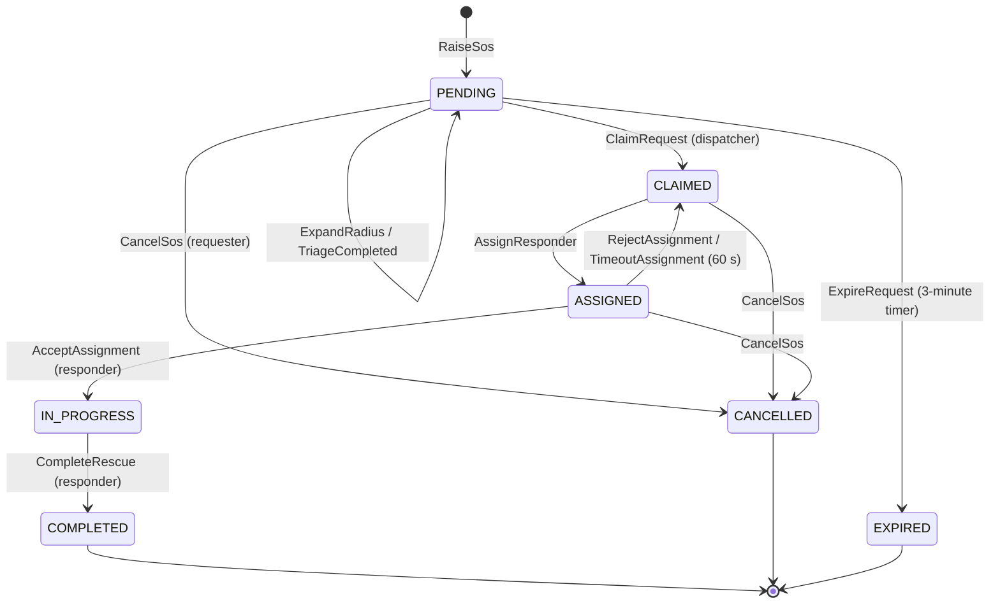
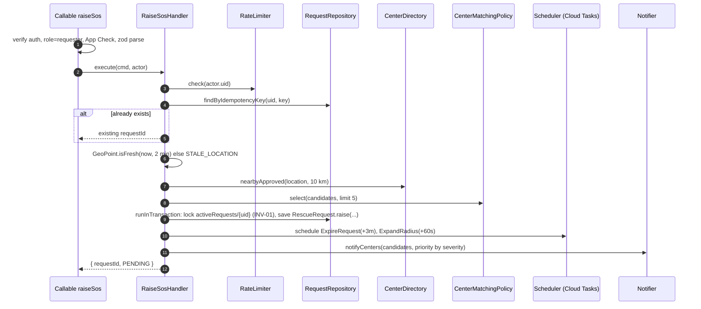
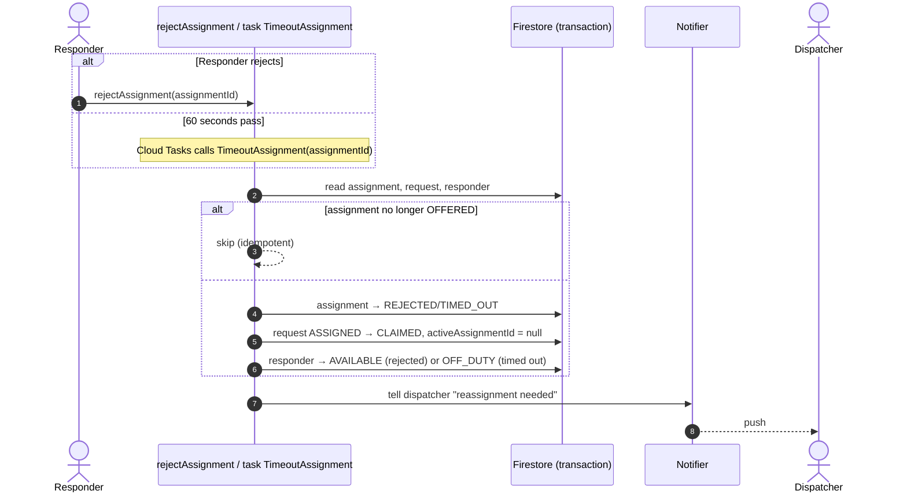
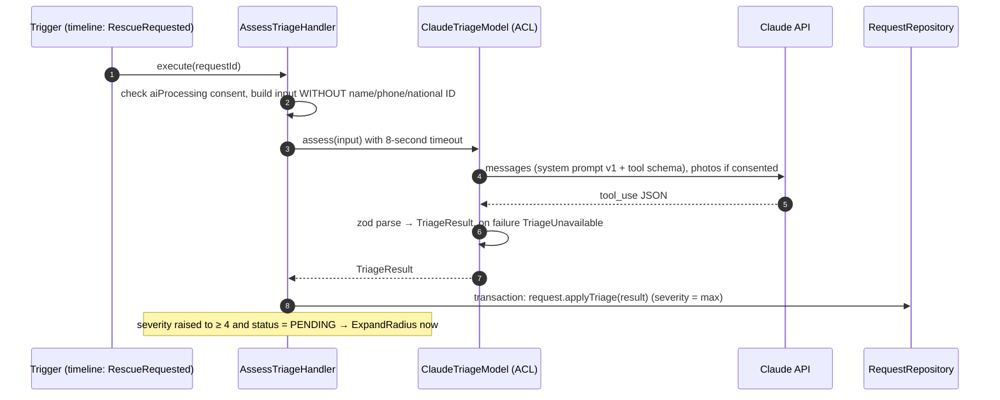

# Low-Level Design (LLD)

Version 1.0 · 2026-10-31 · Status: Proposed

## 1. Source layout (monorepo)

```text
graduation-project/
├─ apps/
│  └─ mobile/                      # React Native app
│     └─ src/
│        ├─ app/                   # navigation, providers, theme
│        ├─ features/
│        │  ├─ sos/                # SOS button, countdown, tracking screen
│        │  ├─ dispatch/           # request list, claim, assign (dispatcher)
│        │  ├─ mission/            # accept work, map, complete (responder)
│        │  ├─ profile/            # profile, medical, emergency contacts
│        │  ├─ notifications/
│        │  └─ auth/
│        │     └─ (each feature: screens/, components/, hooks/, api.ts, __tests__/)
│        └─ shared/                # UI kit, lib (firebase, location), utils
├─ services/
│  └─ functions/
│     └─ src/
│        ├─ application/           # command handlers + ports
│        ├─ infrastructure/        # firestore repos, fcm, sms, cloud tasks, claude
│        ├─ interface/             # callables, triggers, task handlers
│        └─ index.ts               # function exports
├─ packages/
│  ├─ domain/                      # aggregates, VOs, events, policies (pure TS)
│  └─ contracts/                   # zod schemas for callable I/O, shared enums
├─ firebase/
│  ├─ firestore.rules
│  ├─ firestore.indexes.json
│  ├─ storage.rules
│  └─ tests/                       # rules unit tests
├─ e2e/                            # Maestro flows
├─ docs/
└─ .github/workflows/
```

Tooling: pnpm workspaces + Turborepo, TypeScript 5 strict, Vitest for Node packages, Jest + React Native Testing Library for mobile, ESLint (`eslint-plugin-boundaries`), Prettier, Husky + lint-staged.

## 2. Firestore schema

All instants are stored as `Timestamp`. Every aggregate document has `version: number` and `updatedAt`.

### 2.1 `requests/{requestId}`

| Field | Type | Required | Notes |
| --- | --- | --- | --- |
| `requesterId` | string | ✓ | uid |
| `status` | `'PENDING' \| 'CLAIMED' \| 'ASSIGNED' \| 'IN_PROGRESS' \| 'COMPLETED' \| 'CANCELLED' \| 'EXPIRED'` | ✓ | |
| `location` | `{ lat, lng, accuracyM, capturedAt, geohash, address? }` | ✓ | |
| `category` | `IncidentCategory` | ✓ | default `OTHER` |
| `severity` | 1..5 | ✓ | default 3 |
| `severitySource` | `'DEFAULT' \| 'REQUESTER' \| 'AI' \| 'DISPATCHER'` | ✓ | |
| `description` | string ≤ 1000 | | |
| `attachments` | `{ path, contentType }[]` ≤ 3 | | Storage paths |
| `searchRadiusKm` | 10 \| 20 \| 50 | ✓ | |
| `notifiedCenterIds` | string[] ≤ 15 | ✓ | used by read rules |
| `claimedByCenterId` | string \| null | ✓ | |
| `activeAssignmentId` | string \| null | ✓ | |
| `responderId` | string \| null | ✓ | current responder, used by read rules |
| `triage` | `{ category, severity, confidence, summary, firstAid[], needs[], model, promptVersion }` \| null | | |
| `participantIds` | string[] | ✓ | requester + claiming center's dispatchers + responder, for rules |
| `createdAt`, `claimedAt`, `startedAt`, `endedAt` | Timestamp | | |
| `endReason` | `'COMPLETED' \| 'CANCELLED_BY_REQUESTER' \| 'NO_CENTER_AVAILABLE'` | | |
| `idempotencyKey` | string | ✓ | client-generated (UUID v4) |
| `version` | number | ✓ | |

Subcollection `requests/{id}/timeline/{eventId}`: `{ type, actorId, actorRole, from, to, at, data }`.

### 2.2 Other collections

| Collection | Main fields |
| --- | --- |
| `assignments/{id}` | `requestId`, `centerId`, `responderId`, `status` (`OFFERED`/`ACCEPTED`/`REJECTED`/`TIMED_OUT`/`COMPLETED`/`CANCELLED`), `offeredAt`, `respondedAt`, `rejectReason?`, `version` |
| `centers/{id}` | `name`, `address`, `location{lat,lng}`, `geohash`, `registrationStatus`, `availableResponders`, `dispatcherIds[]`, `phone`, `licenseNo`, `version` |
| `responders/{uid}` | `centerId`, `displayName`, `availability`, `currentAssignmentId`, `disabled`, `stats{missions,totalDistanceM,totalDurationS}`, `version` |
| `users/{uid}` | `displayName`, `phone`, `photoURL`, `fcmTokens[]`, `consents{medicalDataSharing,aiProcessing,photoSharing}`, `emergencyContacts[{name,phone,relationship}]` ≤ 5, `createdAt` |
| `users/{uid}/private/medical` | `bloodType` (`A+`…`O-`, `UNKNOWN`), `allergies[]`, `conditions[]`, `medications[]`, `notes`, `updatedAt` |
| `tracking/{requestId}` | `requester{lat,lng,accuracyM,at}`, `responder{lat,lng,accuracyM,heading,at}` |
| `notifications/{id}` | `recipientId`, `type`, `title`, `body`, `data{requestId,assignmentId?}`, `createdAt`, `readAt`; ID = `hash(eventId + recipientId)` for deduplication (NTF-03) |
| `activeRequests/{requesterId}` | `requestId`, `createdAt` (deleted when the request ends) |
| `processedEvents/{eventId}` | `handler`, `at`, TTL 7 days |
| `triageOverrides/{requestId}` | `byDispatcherId`, `category`, `severity`, `at` (TRI-05) |

### 2.3 Indexes

| Collection | Fields | Used for |
| --- | --- | --- |
| `centers` | `registrationStatus ASC, geohash ASC` | Geo query (DSP-01) |
| `requests` | `requesterId ASC, createdAt DESC` | Requester history |
| `requests` | `claimedByCenterId ASC, status ASC, createdAt DESC` | Center's request list |
| `requests` | `notifiedCenterIds ARRAY_CONTAINS, status ASC, createdAt DESC` | Requests awaiting claim for a center |
| `assignments` | `responderId ASC, status ASC` | Current assignment |
| `responders` | `centerId ASC, availability ASC` | Available responders |

## 3. `RescueRequest` state machine



The transition table is a static map in `packages/domain/src/rescue-request/transitions.ts`; `RescueRequest.transition(to, actor)` throws `InvalidTransitionError` when the edge does not exist (INV-05). One test walks the full 7 × 7 matrix to prove every invalid edge is rejected.

`Assignment`: `OFFERED → ACCEPTED → COMPLETED`; `OFFERED → REJECTED | TIMED_OUT | CANCELLED`; `ACCEPTED → CANCELLED` (only if the request is cancelled before start; not allowed in v1).

`Responder.availability`: `OFF_DUTY ⇄ AVAILABLE`, `AVAILABLE → ON_MISSION` (reserve), `ON_MISSION → AVAILABLE` (release). `OFF_DUTY` is not allowed while `ON_MISSION`.

## 4. API contracts (Callable Functions)

Every callable: region `asia-southeast1`, `enforceAppCheck: true`, input validated with zod from `packages/contracts`, errors returned as `HttpsError` with a stable business code in `details.code`.

| Callable | Role | Input | Output | Business errors |
| --- | --- | --- | --- | --- |
| `raiseSos` | requester | `{ idempotencyKey, location{lat,lng,accuracyM,capturedAt}, category?, severity?, description? }` | `{ requestId, status }` | `ACTIVE_REQUEST_EXISTS`, `STALE_LOCATION`, `RATE_LIMITED` |
| `updateSosDetails` | requester (owner) | `{ requestId, category?, description?, attachments? }` | `{ ok }` | `NOT_OWNER`, `REQUEST_CLOSED` |
| `cancelSos` | requester (owner) | `{ requestId, reason? }` | `{ status }` | `NOT_OWNER`, `INVALID_TRANSITION` |
| `claimRequest` | dispatcher | `{ requestId }` | `{ status }` | `NOT_NOTIFIED`, `ALREADY_CLAIMED`, `INVALID_TRANSITION` |
| `assignResponder` | dispatcher (claiming center) | `{ requestId, responderId }` | `{ assignmentId }` | `NOT_CLAIM_OWNER`, `RESPONDER_UNAVAILABLE`, `RESPONDER_NOT_IN_CENTER`, `ASSIGNMENT_ACTIVE` |
| `acceptAssignment` | responder (assignee) | `{ assignmentId, location }` | `{ requestId, status }` | `NOT_ASSIGNEE`, `ASSIGNMENT_CLOSED` |
| `rejectAssignment` | responder (assignee) | `{ assignmentId, reason? }` | `{ ok }` | `NOT_ASSIGNEE`, `ASSIGNMENT_CLOSED` |
| `completeRescue` | responder (assignee) | `{ requestId, distanceM, note? }` | `{ status }` | `NOT_ASSIGNEE`, `INVALID_TRANSITION` |
| `setAvailability` | responder | `{ availability: 'AVAILABLE' \| 'OFF_DUTY' }` | `{ availability }` | `ON_MISSION`, `DISABLED` |
| `createResponder` | dispatcher | `{ displayName, email, tempPassword }` | `{ responderId }` | `EMAIL_EXISTS` |
| `disableResponder` | dispatcher | `{ responderId }` | `{ ok }` | `RESPONDER_NOT_IN_CENTER`, `ON_MISSION` |
| `registerCenter` | signed-in user | `{ name, address, location, phone, licenseNo }` | `{ centerId }` | `ALREADY_REGISTERED` |
| `reviewCenter` | admin | `{ centerId, decision: 'APPROVE' \| 'REJECT', note? }` | `{ status }` | `INVALID_TRANSITION` |
| `overrideTriage` | dispatcher (claiming center) | `{ requestId, category, severity }` | `{ ok }` | `NOT_CLAIM_OWNER` |
| `getMedicalForRescue` | dispatcher/responder on the rescue | `{ requestId }` | `MedicalProfile \| null` | `NOT_PARTICIPANT`, `NO_CONSENT` |
| `registerFcmToken` | any user | `{ token }` | `{ ok }` | |

Example contract:

```ts
// packages/contracts/src/raise-sos.ts
export const RaiseSosInput = z.object({
  idempotencyKey: z.string().uuid(),
  location: z.object({
    lat: z.number().min(-90).max(90),
    lng: z.number().min(-180).max(180),
    accuracyM: z.number().nonnegative().max(5000),
    capturedAt: z.number().int(), // epoch ms
  }),
  category: IncidentCategory.optional(),
  severity: z.number().int().min(1).max(5).optional(),
  description: z.string().max(1000).optional(),
});
export type RaiseSosInput = z.infer<typeof RaiseSosInput>;
export const RaiseSosOutput = z.object({ requestId: z.string(), status: RequestStatus });
```

**Idempotency:** `raiseSos` looks up `requests` by `idempotencyKey` + `requesterId`; a repeated call with the same key returns the existing request instead of creating a new one. Other commands are naturally idempotent through the state machine (a repeated `claimRequest` by the same center succeeds).

## 5. Detailed sequences

### 5.1 `raiseSos`



If no center exists within 10 km, the handler expands to 20 and then 50 km before returning. If there is still none, the request is still created as `PENDING` so the `ExpireRequest` timer handles it, and the requester sees emergency numbers immediately.

### 5.2 Assignment rejection / timeout



### 5.3 Projections and side effects through triggers

Command handlers write the aggregate plus a `timeline` record. The trigger `onDocumentCreated(requests/{id}/timeline/{eventId})` acts as an **outbox**: it reads the event, checks `processedEvents/{eventId}`, then runs the secondary policies (non-urgent notifications, updating `centers.availableResponders`, SMS to relatives, starting triage). The urgent push (notifying centers of a new SOS) is sent directly in `raiseSos` to meet NF-01.

## 6. Timers (Cloud Tasks)

| Task | Scheduled at | Handler does | Skip when |
| --- | --- | --- | --- |
| `ExpandRadius` | +60 s and +120 s after creation | `request.expandRadius()`, notify new centers | status ≠ `PENDING` or already at 50 km |
| `ExpireRequest` | +3 min after creation | `request.expire()`, delete `activeRequests`, push the requester | status ≠ `PENDING` |
| `TimeoutAssignment` | +60 s after assignment | as in §5.2 | assignment ≠ `OFFERED` |

Task names are deterministic (`expire-{requestId}`, `timeout-{assignmentId}`) so Cloud Tasks deduplicates them and they can be cancelled on claim. The `Scheduler` port has `schedule(name, at, payload)` and `cancel(name)`; the test fake records the schedule and lets tests "fast-forward" with `FakeClock`.

## 7. Firestore security rules

Principles: deny by default; clients write only what belongs to them and never business state.

```js
rules_version = '2';
service cloud.firestore {
  match /databases/{db}/documents {
    function signedIn() { return request.auth != null; }
    function role() { return request.auth.token.role; }
    function uid() { return request.auth.uid; }
    function onlyChanges(keys) {
      return request.resource.data.diff(resource.data).affectedKeys().hasOnly(keys);
    }

    match /users/{userId} {
      allow read: if signedIn() && uid() == userId;
      allow create: if signedIn() && uid() == userId
        && !request.resource.data.keys().hasAny(['role', 'fcmTokens']);
      allow update: if signedIn() && uid() == userId
        && onlyChanges(['displayName', 'photoURL', 'consents', 'emergencyContacts'])
        && request.resource.data.emergencyContacts.size() <= 5;

      match /private/medical {
        allow read, write: if signedIn() && uid() == userId;
      }
    }

    match /requests/{requestId} {
      allow read: if signedIn() && (
        uid() in resource.data.participantIds ||
        (role() == 'dispatcher' && request.auth.token.centerId in resource.data.notifiedCenterIds)
      );
      allow write: if false; // Functions only (Admin SDK bypasses rules)

      match /timeline/{eventId} {
        allow read: if signedIn() && uid() in get(/databases/$(db)/documents/requests/$(requestId)).data.participantIds;
        allow write: if false;
      }
    }

    match /tracking/{requestId} {
      function req() { return get(/databases/$(db)/documents/requests/$(requestId)).data; }
      allow read: if signedIn() && uid() in req().participantIds;
      allow update: if signedIn() && req().status in ['ASSIGNED', 'IN_PROGRESS'] && (
        (uid() == req().requesterId && onlyChanges(['requester'])) ||
        (uid() == req().responderId && onlyChanges(['responder']))
      );
    }

    match /centers/{centerId} {
      allow read: if signedIn();
      allow update: if role() == 'dispatcher' && request.auth.token.centerId == centerId
        && onlyChanges(['name', 'address', 'phone']);
    }

    match /responders/{responderId} {
      allow read: if signedIn() && (uid() == responderId ||
        (role() == 'dispatcher' && request.auth.token.centerId == resource.data.centerId));
    }

    match /assignments/{id} {
      allow read: if signedIn() && (uid() == resource.data.responderId ||
        (role() == 'dispatcher' && request.auth.token.centerId == resource.data.centerId));
    }

    match /notifications/{id} {
      allow read: if signedIn() && uid() == resource.data.recipientId;
      allow update: if signedIn() && uid() == resource.data.recipientId && onlyChanges(['readAt']);
    }
  }
}
```

Storage: `requests/{requestId}/{file}` may be uploaded only by the owning requester (≤ 5 MB, `image/*`) and read by rescue participants. Storage rules read Firestore with `firestore.get()`.

## 8. AI triage



- **Model:** `claude-haiku-5-5` for text only, `claude-sonnet-5-5` when photos are attached. The model id and `promptVersion` are stored in `triage` for traceability.
- **Output schema** (tool `report_triage`): `category` (TRI-01 enum), `severity` (1..5), `confidence` (0..1), `summary` (≤ 160 characters, Vietnamese), `firstAid` (3..5 strings), `needs` (enum array).
- **Prompt** lives in `services/functions/src/infrastructure/triage/prompts/v1.md`, instructing: when unsure, choose the higher severity; never give a medical diagnosis; first aid follows general public guidance.
- **Resilience:** 8-second timeout, one retry on 5xx/429, a simple circuit breaker (disable AI for 5 minutes after 5 consecutive failures). Every failure is logged, never thrown out of the handler.
- **Secret:** `ANTHROPIC_API_KEY` via `defineSecret`.
- **Evaluation:** `services/functions/eval/triage-cases.jsonl` (50 to 100 labelled cases); `pnpm eval:triage` prints a confusion matrix and the under-triage rate.

## 9. Mobile app

- **Server state:** Firestore listeners wrapped in per-feature hooks (`useRescueRequest(id)`, `usePendingRequestsForCenter()`), returning `{ data, error, loading }`; commands go through the feature's `api.ts` using `httpsCallable` + zod output parsing.
- **Errors:** every command returns `Result<T, AppError>`; `AppError` maps `details.code` to a localized message; no empty `catch {}` (ESLint `no-empty` as error).
- **SOS button:** a small client-side state machine `idle → holding → countdown → sending → sent | failed`; on `failed` due to no network, the request is queued (AsyncStorage) and retried with backoff, and a "Call 115" button is shown.
- **Location:** `react-native-geolocation-service` (drop `@react-native-community/geolocation`), fresh fix with `maximumAge: 120000`; Android foreground service while a rescue is active.
- **Notifications:** `@react-native-firebase/messaging` + Notifee (replacing the unmaintained `react-native-push-notification`), high-priority channel `sos-critical`.
- **Role-based navigation:** read `role` from ID token claims (`getIdTokenResult`), not from Firestore.

## 10. Error handling and observability

| Layer | Approach |
| --- | --- |
| Domain | Errors are classes with a `code` (`InvalidTransitionError`, `InvariantViolation`) |
| Application | Map domain errors to `HttpsError('failed-precondition', msg, { code })` |
| Infrastructure | Bounded retries; unrecoverable errors logged with `severity=ERROR` and `requestId` |
| Logs | `firebase-functions/logger` JSON: `requestId`, `eventId`, `actorId` (never phone numbers or descriptions) |
| Alerts | Cloud Monitoring: function errors > 1% / 5 min; Cloud Tasks backlog > 50; `raiseSos` p95 > 3 seconds |
