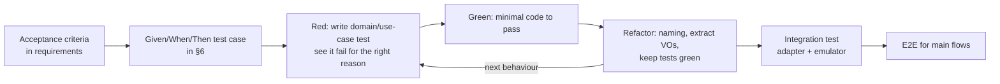

# Test Strategy (TDD)

Version 1.0 · 2026-10-31 · Status: Proposed · Decision: [ADR-0010](../04-adr/0010-tdd-with-emulator.md)

## 1. Principles

1. **Test first, code second** for all code in `packages/domain` and `services/api/src/application`. Business code does not merge unless a failing test preceded it in the PR's commit history (reviewers check).
2. **Test behaviour, not implementation:** test names are business sentences in the ubiquitous language (`rejects claim when request already claimed by another center`).
3. **Every bug becomes a test:** write a test reproducing the bug before fixing it.
4. **One reason to fail per test:** clear Arrange / Act / Assert, one behaviour per test.
5. **Time is an input:** no `Date.now()` in the domain; use `Clock`, and `FakeClock` in tests.

## 2. The TDD loop in this project



Commit rhythm: `test: …` (red) → `feat: …` (green) → `refactor: …`. Separate commits are optional but encouraged, to show the process in the portfolio.

## 3. Test pyramid

| Layer | Tooling | Scope | Share of tests | Target runtime |
| --- | --- | --- | --- | --- |
| Domain unit | Vitest | Aggregates, VOs, policies, state machine | ~60% | < 5 s total |
| Use case | Vitest + fake adapters | Command handlers, permissions, cross-aggregate invariants | ~20% | < 10 s |
| Integration | Jest + Firestore/Auth emulators | Firestore repositories + transactions, rules, BullMQ processors (with a real Redis in CI) | ~10% | < 2 min |
| API e2e | Jest + Supertest | Nest app over HTTP: auth guard, role checks, validation, error mapping | ~2% | < 30 s |
| Contract | Vitest | zod schemas in `packages/contracts`; Claude adapter against recorded fixtures | ~3% | < 5 s |
| Mobile component | Jest + React Native Testing Library | Hooks, SOS screen, error handling | ~4% | < 1 min |
| E2E | Maestro on Android emulator | 3 main flows | ~1% | < 5 min |

## 4. Test doubles

| Port | Test fake | Notes |
| --- | --- | --- |
| `Clock` | `FakeClock` | `advance(ms)` |
| `RequestRepository`, `AssignmentRepository`, `ResponderRepository` | `InMemory*Repository` | Simulates `version` to test conflicts |
| `UnitOfWork` | `InMemoryUnitOfWork` | Commit/rollback on a copy |
| `Scheduler` | `FakeScheduler` | Records schedule; `runDue(clock)` runs due tasks |
| `Notifier` | `RecordingNotifier` | Assert recipients, type, priority |
| `CenterDirectory` | `StaticCenterDirectory` | Centers with fixed coordinates |
| `TriageModel` | `StubTriageModel` | Fixed result, error, or hang to test the timeout |

Mock only at the boundary (ports). Never mock aggregates or value objects.

## 5. Test examples

Domain unit:

```ts
// packages/domain/src/rescue-request/rescue-request.spec.ts
describe('RescueRequest.claim', () => {
  it('moves PENDING to CLAIMED and records the center', () => {
    const req = aPendingRequest({ notifiedCenterIds: ['c1', 'c2'] });

    req.claim(CenterId('c1'), clock.now());

    expect(req.status).toBe('CLAIMED');
    expect(req.claimedBy).toEqual(CenterId('c1'));
    expect(req.pullEvents()).toContainEqual(expect.objectContaining({ type: 'RequestClaimed' }));
  });

  it('rejects a second claim by another center (INV-02)', () => {
    const req = aPendingRequest({ notifiedCenterIds: ['c1', 'c2'] });
    req.claim(CenterId('c1'), clock.now());

    expect(() => req.claim(CenterId('c2'), clock.now())).toThrow(AlreadyClaimedError);
  });
});
```

Use case with a timer:

```ts
// services/api/test/application/expire-request.spec.ts
it('expires an unclaimed request after 3 minutes and frees the requester', async () => {
  const { handler, scheduler, clock, repo, notifier } = setup();
  const { requestId } = await raiseSos(handler, { requesterId: 'u1' });

  clock.advance(minutes(3));
  await scheduler.runDue(clock);

  expect((await repo.get(requestId)).status).toBe('EXPIRED');
  expect(await repo.hasActiveRequest('u1')).toBe(false);
  expect(notifier.sentTo('u1')).toContainEqual(expect.objectContaining({ type: 'RESCUE_EXPIRED' }));
});
```

Rules:

```ts
// firebase/tests/requests.rules.spec.ts
it('denies a requester writing status directly', async () => {
  const db = env.authenticatedContext('u1', { role: 'requester' }).firestore();
  await assertFails(updateDoc(doc(db, 'requests/r1'), { status: 'COMPLETED' }));
});
```

Contention on the emulator:

```ts
it('lets exactly one of two concurrent claims succeed (DSP-03, NF-04)', async () => {
  const r = await seedPendingRequest({ notifiedCenterIds: ['c1', 'c2'] });
  const results = await Promise.allSettled([
    claim(r.id, dispatcherOf('c1')),
    claim(r.id, dispatcherOf('c2')),
  ]);
  expect(results.filter((x) => x.status === 'fulfilled')).toHaveLength(1);
});
```

## 6. Seed test case catalog (TDD)

Each row is a test written **before** the code. "Layer": U = domain unit, A = use case, I = integration, R = rules, C = contract, M = mobile, E = E2E. "Old bug" marks tests that reproduce a defect seen in the current code.

### 6.1 RescueRequest and the state machine

| ID | Given | When | Then | Layer | Req | Old bug |
| --- | --- | --- | --- | --- | --- | --- |
| T-REQ-01 | Requester with no active request, fresh location | RaiseSos | `PENDING` created, `RescueRequested` emitted | U | SOS-01 | |
| T-REQ-02 | Location `capturedAt` 3 minutes old | RaiseSos | `STALE_LOCATION` error | U | SOS-02 | ✓ |
| T-REQ-03 | Requester already has a `PENDING` request | RaiseSos | `ACTIVE_REQUEST_EXISTS` error | A | SOS-04, INV-01 | ✓ |
| T-REQ-04 | Same `idempotencyKey` sent twice | RaiseSos | Same `requestId`, one document only | A | NF-03 | |
| T-REQ-05 | 7 × 7 status matrix | `transition(from, to)` | Only LLD §3 edges are valid; all others throw `InvalidTransitionError` | U | INV-05 | |
| T-REQ-06 | Request `IN_PROGRESS` | CancelSos | `INVALID_TRANSITION` error | U | SOS-05 | |
| T-REQ-07 | Request `ASSIGNED` | CancelSos by owner | `CANCELLED`, assignment `CANCELLED`, responder `AVAILABLE` | A | SOS-05 | |
| T-REQ-08 | Request owned by u1 | CancelSos by u2 | `NOT_OWNER` error | A | INV-07 | ✓ |
| T-REQ-09 | Severity 3 | Apply triage severity 2 | Still 3 | U | INV-06, TRI-04 | |
| T-REQ-10 | Severity 3 | Apply triage severity 5 | 5, `severitySource = AI` | U | INV-06 | |

### 6.2 Dispatch

| ID | Given | When | Then | Layer | Req | Old bug |
| --- | --- | --- | --- | --- | --- | --- |
| T-DSP-01 | Center 2 km away but in another province | Find candidates | That center is included | U | DSP-01 | ✓ |
| T-DSP-02 | 8 centers within 10 km | Find candidates | Exactly the 5 nearest, sorted by distance | U | DSP-02 | |
| T-DSP-03 | No center within 10 km, one at 18 km | RaiseSos | `searchRadiusKm = 20`, the 18 km center is notified | A | DSP-01 | |
| T-DSP-04 | Center `PENDING` approval or `availableResponders = 0` | Find candidates | Excluded | U | DSP-01 | |
| T-DSP-05 | `PENDING`, nobody claims | Advance 3 min + run task | `EXPIRED`, requester notified, INV-01 lock released | A | DSP-04 | ✓ |
| T-DSP-06 | Already `CLAIMED` | Late ExpireRequest task runs | Nothing changes (idempotent) | A | NF-03 | |
| T-DSP-07 | Two centers claim concurrently | ClaimRequest × 2 | Exactly one succeeds, the other gets `ALREADY_CLAIMED` | I | DSP-03, NF-04 | ✓ |
| T-DSP-08 | Center not in `notifiedCenterIds` | ClaimRequest | `NOT_NOTIFIED` | A | DSP-03 | |
| T-DSP-09 | Responder belongs to another center | AssignResponder | `RESPONDER_NOT_IN_CENTER` | A | DSP-05, INV-04 | ✓ |
| T-DSP-10 | Responder `ON_MISSION` | AssignResponder | `RESPONDER_UNAVAILABLE` | U | INV-04 | |
| T-DSP-11 | An `OFFERED` assignment exists | AssignResponder again | `ASSIGNMENT_ACTIVE` | U | INV-03 | |
| T-DSP-12 | Assignment `OFFERED` | Responder rejects | Assignment `REJECTED`, request `CLAIMED`, responder `AVAILABLE`, dispatcher notified | A | DSP-06 | ✓ |
| T-DSP-13 | Assignment `OFFERED` | Advance 60 s + run task | `TIMED_OUT`, request `CLAIMED`, responder `OFF_DUTY` | A | DSP-06 | ✓ |
| T-DSP-14 | Assignment already `ACCEPTED` | TimeoutAssignment task runs | Nothing changes | A | NF-03 | |
| T-DSP-15 | Request `PENDING` with severity 2 | Triage returns severity 5 | Radius expands immediately, high-priority push | A | DSP-07 | |
| T-DSP-16 | Responder `ACCEPTED` | CompleteRescue with `distanceM = 4200` | Request `COMPLETED`, responder `AVAILABLE`, `stats.totalDistanceM += 4200` exactly once | A | DSP-09, TRK-02 | ✓ |
| T-DSP-17 | `RescueCompleted` delivered twice | Outbox processes it | Stats and notifications increase only once | I | NTF-03 | ✓ |
| T-DSP-18 | Last `AVAILABLE` responder of a center deleted | Projection runs | `availableResponders = 0`, no error thrown | I | CTR-03 | ✓ |

### 6.3 Triage

| ID | Given | When | Then | Layer | Req |
| --- | --- | --- | --- | --- | --- |
| T-TRI-01 | Stub returns valid JSON | AssessTriage | `triage` written, severity by max | A | TRI-01..03 |
| T-TRI-02 | Stub hangs for 10 s | AssessTriage | Aborted after 8 s, no `triage` written, no error thrown | A | NF-02, TRI-04 |
| T-TRI-03 | Claude returns JSON that breaks the schema | Adapter parses | `TriageUnavailable`, warning logged | C | TRI-01 |
| T-TRI-04 | Requester has not consented to `aiProcessing` | AssessTriage | Model is not called | A | NF-07 |
| T-TRI-05 | Profile has name and phone | Build input | Input contains no name, phone or national ID | U | NF-07 |
| T-TRI-06 | AI disabled via feature flag | RaiseSos | Flow identical to AI-enabled except `triage` | A | TRI-04 |
| T-TRI-07 | Eval set | `pnpm eval:triage` | Under-triage = 0, category accuracy ≥ 80% | Eval | TRI-02 |

### 6.4 Rules and privacy

| ID | Given | When | Then | Layer | Req |
| --- | --- | --- | --- | --- | --- |
| T-RUL-01 | Not signed in | Read any collection | Denied | R | NF-05 |
| T-RUL-02 | Requester | Write `requests/*` | Denied | R | AUT-02 |
| T-RUL-03 | User | Set their own `role` in `users/{uid}` | Denied | R | AUT-01 |
| T-RUL-04 | Dispatcher of center c1 | Read a request that only notified c2 | Denied | R | INV-08 |
| T-RUL-05 | Responder on the rescue | Read `users/{requester}/private/medical` directly | Denied (must use the API) | R | INV-08 |
| T-RUL-06 | Responder on an `IN_PROGRESS` rescue, consent on | `getMedicalForRescue` | Returns profile, writes audit entry | I | PRF-04 |
| T-RUL-07 | Rescue already `COMPLETED` | `getMedicalForRescue` | `NOT_PARTICIPANT` or denied | I | PRF-04 |
| T-RUL-08 | Requester on the rescue | Write `tracking/{id}.responder` | Denied | R | TRK-01 |
| T-RUL-09 | Anyone who is not a dispatcher | Call `createResponder` | `permission-denied` | I | CTR-02 |

### 6.5 Mobile

| ID | Given | When | Then | Layer | Req |
| --- | --- | --- | --- | --- | --- |
| T-MOB-01 | Home screen | Hold SOS 1 s then release | Nothing sent | M | SOS-01 |
| T-MOB-02 | Hold 3 s, let the countdown finish | | `raiseSos` called exactly once, tracking screen shown | M | SOS-01 |
| T-MOB-03 | During the countdown | Press Cancel | `raiseSos` not called | M | SOS-01 |
| T-MOB-04 | `raiseSos` fails with a network error | | Error shown, queued for retry, "Call 115" button shown | M | SOS-06 |
| T-MOB-05 | API returns `ACTIVE_REQUEST_EXISTS` | | Navigates to the existing request, no blank screen | M | SOS-04 |
| T-MOB-06 | Not signed in | Open the app | Not stuck on loading for more than 3 s | M | |

### 6.6 E2E (Maestro)

| ID | Flow |
| --- | --- |
| T-E2E-01 | Requester raises SOS → dispatcher claims → assigns → responder accepts → completes; all three see final status `COMPLETED` |
| T-E2E-02 | Requester raises SOS → nobody claims → after 3 minutes (10 seconds in the test environment) sees `EXPIRED` and the "Call 115" button |
| T-E2E-03 | Responder rejects → dispatcher is notified → assigns someone else |

## 7. Test data

- Builders in the ubiquitous language: `aPendingRequest()`, `aCenter().at(HANOI_HOAN_KIEM).approved()`, `aResponder().available().of('c1')`.
- Fixed sample coordinates in `packages/domain/test/geo-fixtures.ts` (Hoan Kiem, Long Bien, the Hanoi/Bac Ninh border) to test DSP-01.
- Emulator seed: `pnpm seed:emulator` creates 1 admin, 3 centers, 6 responders, 3 requesters.

## 8. CI gates

| Gate | Tool | Threshold to merge |
| --- | --- | --- |
| Lint + format | ESLint, Prettier | 0 errors |
| Architecture | `eslint-plugin-boundaries` | 0 dependency violations |
| Typecheck | `tsc --noEmit` | 0 errors |
| Unit + use case | Vitest | 100% pass |
| Coverage | Vitest v8 | `packages/domain` ≥ 90% lines, ≥ 85% branches; `application` ≥ 80% |
| Integration + rules | Vitest + Emulator | 100% pass |
| Mobile | Jest + RNTL | 100% pass |
| Secrets | gitleaks | 0 findings |
| E2E | Maestro | Nightly and before release tags |
| Mutation (optional) | Stryker on `packages/domain` | Mutation score ≥ 70%, reported, not blocking |

## 9. Definition of Done for a user story

- [ ] Acceptance criteria are turned into test cases in §6 (or new rows are added).
- [ ] Tests were written first and failed at least once.
- [ ] Every CI gate is green.
- [ ] LLD / contracts updated if the API or schema changed.
- [ ] No empty `catch {}`, no new `any`.
- [ ] Tried on an Android emulator at least once.
