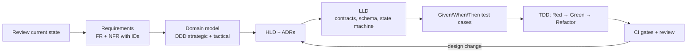

# SOS App Engineering Docs

These documents describe the **target state (to-be)** of SOS App after the refactor, with the current state (as-is) where a comparison helps. They follow a "design first, code second" process: requirements, then the domain model, then high-level design, then low-level design. Every piece of code written later must trace back to a requirement and a test.

Date: 2026-10-31 · Status: **Proposed** (not yet implemented)

## Reading order

| # | Document | Answers | Primary readers |
| --- | --- | --- | --- |
| 1 | [01-plan/roadmap.md](01-plan/roadmap.md) | What we build, in what order, by when | Everyone |
| 2 | [01-plan/requirements.md](01-plan/requirements.md) | What the system must do (FR) and how well (NFR) | PO, Dev, QA |
| 3 | [02-domain/domain-model.md](02-domain/domain-model.md) | How the business is modelled (DDD) | Dev |
| 4 | [03-design/hld.md](03-design/hld.md) | Major building blocks, how they talk, where they run | Dev, DevOps |
| 5 | [03-design/lld.md](03-design/lld.md) | Schema, API contracts, state machine, sequences, rules | Dev |
| 6 | [04-adr/](04-adr/README.md) | Why we chose this over the alternatives | Dev, reviewers |
| 7 | [05-testing/test-strategy.md](05-testing/test-strategy.md) | How we write tests with TDD, what we test, CI gates | Dev, QA |

## Workflow

## Conventions

- **Requirement IDs** are stable and never reused: `SOS-`, `DSP-`, `TRI-`, `PRF-`, `NTF-`, `CTR-`, `AUT-`, `TRK-`, `NF-` (see requirements).
- **ADRs** are numbered sequentially. An `Accepted` ADR is never edited; to change a decision, write a new ADR marked `Supersedes ADR-xxxx`.
- **Ubiquitous Language**: names in code must match the glossary in [domain-model.md](02-domain/domain-model.md#1-ubiquitous-language). For example, code says `RescueRequest`, not `message`.
- When code changes, update the matching LLD section and test cases **in the same PR**.
- Diagrams use Mermaid so they render directly on GitHub.
